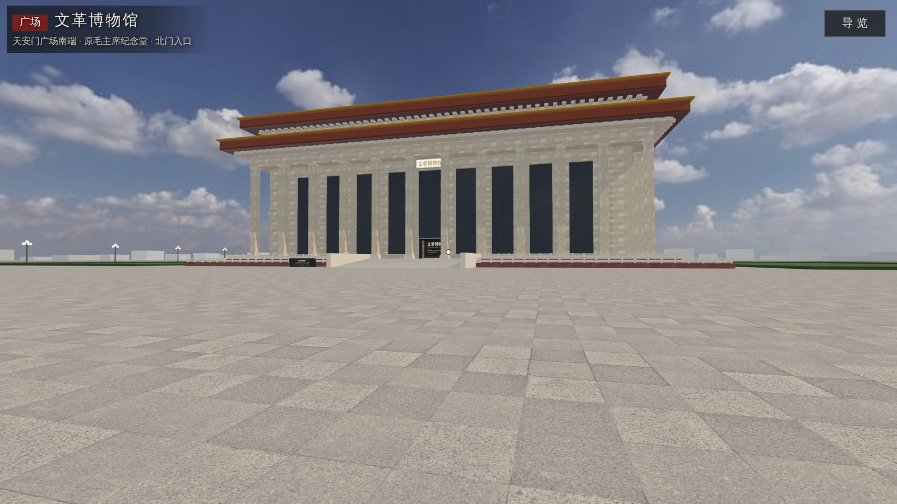
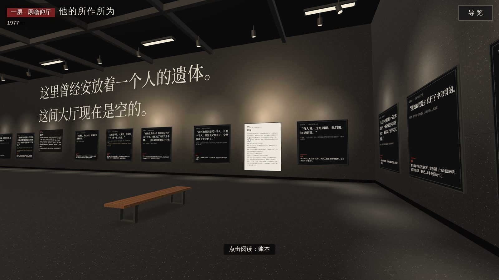
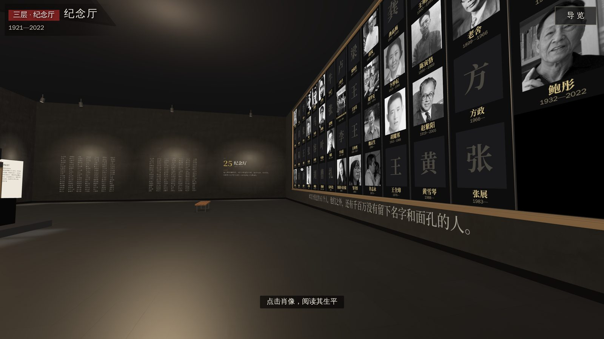
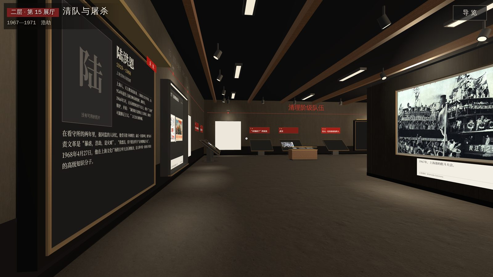
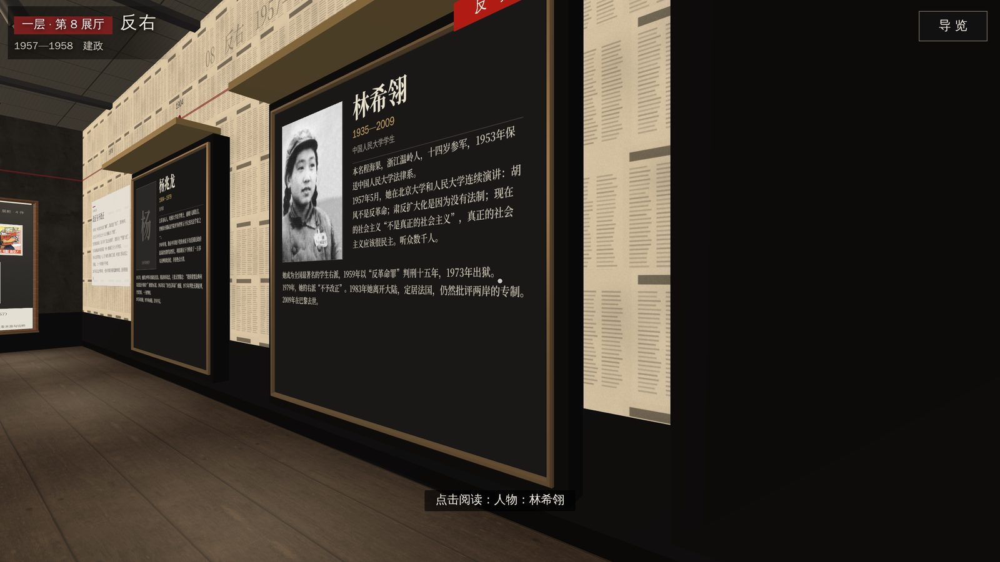

<div align="center">

# 文革博物馆 · 3D 虚拟馆

**一座构想中的博物馆：把天安门广场上的毛主席纪念堂，改建为文革博物馆。**

在浏览器里步行参观，三层楼、二十四个展厅，记录 1921—2022 年中国的政治暴力与受难者。

[](LICENSE)
[](LICENSE-CONTENT.md)
[](https://threejs.org/)
[](#快速开始)

[快速开始](#快速开始) · [展线](#展线) · [特色](#特色) · [史实原则](#史实与证据) · [参与贡献](#参与贡献) · [许可](#许可与版权) · [English](#english)

<br>



<br>

> “建立‘文革’博物馆，这不是某一个人的事情，我们谁都有责任让子子孙孙、世世代代牢记十年惨痛的教训。”
>
> —— 巴金，《“文革”博物馆》，1986

</div>

<br>

## 这是什么

1986 年，巴金提议建立一座“文革”博物馆。四十年过去，这座博物馆仍然只存在于想象之中。

这个项目把它建了出来，地点选在最有分量的地方：天安门广场南端的毛主席纪念堂。参观者从北门台阶走进展馆，一路单向前行，经过二十年代的暴动与苏区肃反、土改、镇反、反右、大饥荒、文化大革命，一直走到 2022 年的封城，最后在纪念厅里面对受难者的名字和面孔，从南门回到广场。

整个展馆是一个纯静态网页，用 three.js 实时渲染。所有展陈文字都可点开阅读全文，附有来源与证据说明。浏览器打不开三维场景时，还有一份不依赖 WebGL 的文字导览（`guide.html`，构建时生成）。

<table>
  <tr>
    <td width="50%"><br><sub><b>原瞻仰厅 · 他的所作所为</b>　不展示遗容，展示他说过的话和“此后”发生的事</sub></td>
    <td width="50%"><br><sub><b>纪念厅</b>　肖像墙与 663 位受难者的名字</sub></td>
  </tr>
  <tr>
    <td width="50%"><br><sub><b>第 15 展厅 · 清队与屠杀</b>　每厅一种时代风格，墙顶刷着当年的标语</sub></td>
    <td width="50%"><br><sub><b>第 8 展厅 · 反右</b>　贴满报纸的墙，人物灯箱与红色“反抗”标记</sub></td>
  </tr>
</table>

## 展线

全程单向参观，中途没有出口。

| 楼层 | 年代 | 展厅 |
| :-- | :-- | :-- |
| **一层**　革命的暗面与建政 | 1921—1958 | 序厅 · 原瞻仰厅 · ① 革命道路与苏区肃反 · ② 延安 · ③ 内战与围城 · ④ 土地改革 · ⑤ 镇压反革命 · ⑥ 韩战 · ⑦ 改造 · ⑧ 反右 |
| **二层**　乌托邦与浩劫 | 1958—1976 | ⑨ 大跃进 · ⑩ 大饥荒 · ⑪ 饥荒之后 · ⑫ 文革爆发 · ⑬ 红色恐怖 · ⑭ 夺权与武斗 · ⑮ 清队与屠杀 · ⑯ 落幕 |
| **三层**　未完成的告别 | 1976—2022 | ⑰ 转折 · ⑱ 计划生育 · ⑲ 严打与八十年代 · ⑳ 一九八九 · ㉑ 维稳年代 · ㉒ 边疆与香港 · ㉓ 收紧 · ㉔ 封城 · 纪念厅 |

## 特色

**展陈**

- 🏛️ **二十七个空间、近千件展项**：展板、54 座专题阅读台、61 位人物、46 张故事卡、16 组个案详案、67 组文物展柜（247 件影像）、18 处禁书书架，每厅一台档案查阅机。
- 🔴 **“反抗”标记**：各厅都有说“不”的人，比如林昭、遇罗克、冯元春、徐洪慈、黄立众、张志新、刘晓波和白纸运动的参与者，一共 60 处。
- 🧾 **原瞻仰厅：他的所作所为**：空的水晶棺；一个与天安门城楼画像同样大小的空画框；十三张“证词”卡，写着毛泽东本人的原话，下面是“此后”发生的事；地面上是一本按死亡人数堆砌的“账本”。
- 🧱 **入口冲击区**：走进每个展厅，迎面是一个数字和一件装置。苏区肃反的“近 100,000”前面立着一千根木桩，大饥荒的“3600 万”前面是摆满空碗的公共食堂，封城厅则是一张巨大的白纸。
- 🎨 **每厅一种时代风格**：苏区的夯土墙、五十年代机关的绿墙裙、一九五七年贴满报纸的墙、红八月的血红、封控时期的蓝色彩钢围挡，墙顶刷着当年真实的标语。
- 📖 **名词展签**：划成分、诉苦与斗争会、“千分之一”、杀关管、劳动教养、公安六条……解释当时的专有名词。

**技术**

- ⚡ **纯静态**：没有后端，也没有框架，ES 模块直接运行；发布前用 esbuild 打成一个包。
- 🖼️ **高清而不卡**：按屏幕原生像素比渲染；展板贴图在后台线程（OffscreenCanvas）绘制，近处换高清；图片按厅打成小图包，先显示、后换清晰版。
- 🛟 **进馆失败有兜底**：浏览器不支持 WebGL、程序下载失败或长时间没有进展时，页面会提示原因，提供重试按钮和文字导览。
- 💬 **匿名留言与在馆人数**（可选）：Cloudflare Worker + Durable Object，经 WebSocket 收发。不部署时展馆照常运行。

## 快速开始

需要一个能提供静态文件的 HTTP 服务器（ES 模块不能从 `file://` 加载）：

```sh
# 在已克隆或解压的项目目录中运行
python3 -m http.server 8000
# 打开 http://localhost:8000
```

开发时这样就够了，改完刷新即可。

### 构建发布版

```sh
npm install       # 只装 esbuild，用于打包
npm run build     # = python3 tools/pack.py，输出到 dist/（需要 Pillow 生成小图）
```

构建会做这些事：

- 把展柜与档案柜图片合并成按厅分组的图片包，另生成最长边 400 像素的小图包；
- 把主程序（含 three.js 与全部展陈文字）打包压缩成 `js/app.js`；
- 生成文字导览 `guide.html`。

`dist/` 可以部署到任何静态托管（Cloudflare Pages、GitHub Pages、Netlify……）。留言服务的部署见 [cloudflare/DEPLOY.md](cloudflare/DEPLOY.md)。

开场页可以显示源代码仓库的链接：把地址填进根目录 `github-link.js` 里的 `githubAddress`（只接受 `https://github.com/…`），留空则不显示。

### 小技巧

| 网址 | 作用 |
| :-- | :-- |
| `#H12` | 直接进入某个展厅（`#A` 序厅、`#B` 原瞻仰厅、`#H1`—`#H24`、`#MEM` 纪念厅） |
| `?noworker` | 不用后台绘制线程（排查兼容问题） |
| `guide.html` | 纯文字导览，按参观顺序列出全部展陈文字（构建后在 `dist/` 里） |

## 操作

| | 电脑 | 手机 |
| :-- | :-- | :-- |
| 移动 | `W` `A` `S` `D` / 方向键，`Shift` 加速 | 左下角摇杆 |
| 转向 | 鼠标 | 滑动屏幕 |
| 阅读 | 点击展项；空格关闭 | 轻点展项 |
| 导览 | `M` | 右上角“导览” |
| 留言 | `T` | 右上角对话图标 |

## 项目结构

```text
museum/
├── index.html              开场页、加载进度与进馆失败的兜底
├── github-link.js          开场页的源代码链接（地址留空则不显示）
├── css/style.css           界面样式
├── js/
│   ├── main.js             场馆搭建、展项沿参观路线排布、行走与交互、阅读页
│   ├── plan.js             平面图：房间、隔墙、门、参观路线、楼梯与电梯
│   ├── design.js           各厅的时代风格（材质、墙裙、色调、标语）与入口大字
│   ├── draw.js             展板、展柜、专题台等的画布绘制（主线程与绘制线程共用）
│   ├── drawworker.js       后台绘制线程
│   ├── scenes.js           入口装置与场景复原
│   ├── exterior.js         天安门广场与周边建筑
│   ├── chat.js             匿名留言与在馆人数（前端）：消息短暂浮现，访客可自取名字
│   ├── content/            ★ 全部展陈文字与著录（见下）
│   └── vendor/             three.js r187
├── assets/                 照片、文物与档案影像、字体子集、建筑饰面
├── tools/                  打包、字体子集、文字导览、配图收集等脚本
├── cloudflare/             留言服务（Worker + Durable Object）
├── functions/              Cloudflare Pages Function：/api/ws 转发
└── docs/screenshots/       本 README 的截图
```

展陈内容都在 `js/content/`，改文字不需要碰渲染代码：

| 文件 | 内容 |
| :-- | :-- |
| `floor1.js` `floor2.js` `floor3.js` `base.js` | 各厅的导言、展板、引文 |
| `features.js` `more.js` | 专题阅读台（正文、背板的图表 / 地图 / 时间线、附文） |
| `stories.js` `extra.js` `selected30.js` | 故事卡、“反抗”卡、选题 |
| `dossiers.js` | 个案详案、串联短签、展签 |
| `people.js` | 人物生平 |
| `artifacts.js` `archive.js` | 文物展柜与档案柜的著录 |
| `curate.js` | 精选规则：撤下的展项、换上的名词展签 |
| `index.js` | 按参观顺序组装全部章节 |

## 史实与证据

这是一座讲述历史的展馆，可信是第一位的。

- **每一块展板都附来源。** 来源包括公开的研究、回忆录、官方文件、档案汇编和媒体报道。点开展项即可看到来源链接。
- **写明证据边界。** 数字口径不同的，并列各家说法；只出自回忆或单方陈述的，在“证据边界”里写明；有争议的，不替读者选定结论。
- **只用可公开使用的影像。** 墙上的历史照片和专题配图，都是维基共享资源上的公有领域或自由许可文件。没有可用影像的事件（夹边沟、道县……），墙上就只有文字。
- **展陈文字未经专业史学审校。** 引用前请核对原始出处。

> [!NOTE]
> 天安门城楼上的空画框、纪念堂的新匾额，属于本构想的设定，不是现实。展柜里的“实物”是按原物形制制作的数字复制品。

## 参与贡献

非常欢迎指正和补充，尤其是史实方面。

- **纠错**：请开一个 Issue，写明展厅、展项标题、错在哪里，并附上可核对的来源。
- **补充展项**：内容在 `js/content/`。新增专题台可参照 `features.js` 里已有的条目（`after` 指定插在哪件展项之后，`replaces` 替换同题展项）。
- **影像**：请只提交公有领域或 CC 许可的图片，并在 `CREDITS.md` 中写明来源与许可。
- **提交前**：在本地打开展馆走一遍；改了内容后可运行 `node tools/guide.mjs /tmp/guide.html` 生成文字导览，检查文字是否完整。

## 公开发布前检查提交身份

用干净的源码快照初始化 Git。在 GitHub 的 **Settings → Emails** 开启邮箱隐私和阻止暴露邮箱的推送，再将该账号的 GitHub `noreply` 地址设为这个仓库的提交邮箱。

```sh
git config --local user.name '发布账号显示名'
git config --local user.email '在 GitHub 邮箱设置中复制的 noreply 地址'
```

提交后再运行 `npm run check:release`。它会检查可达历史中的作者和提交者邮箱及提交正文，输出问题所在的提交号，方便在公开推送前处理。使用 GitHub 网页上传时，先核对该账号的邮箱隐私设置。

## 许可与版权

| 内容 | 许可 |
| :-- | :-- |
| 程序代码 | [MIT](LICENSE) |
| 本馆撰写的展陈文字 | [CC BY-SA 4.0](LICENSE-CONTENT.md) |
| 历史照片、专题配图 | 公有领域或 CC 许可，逐项见 [CREDITS.md](CREDITS.md) |
| 文物展柜、档案柜影像 | 来自各收藏机构与公开来源，权利状态逐件不同，见各展项的来源说明 |
| 引文、附文（如铁流的文章）、受难者名单 | 版权归原作者 |
| Noto Serif SC 字体子集 | SIL Open Font License 1.1 |
| 建筑饰面与天空 | Poly Haven，CC0 |
| three.js | MIT |

## 致谢

- 历史素材库 提供了文物、档案影像与著录。
- 王友琴《文革受难者》提供了纪念厅的受难者名录。
- 历史照片来自维基共享资源上的诸多上传者与收藏机构。
- 感谢每一位记录、追索、保存这段历史的研究者、记者、亲历者和家属。展板上的大部分事实，来自他们冒着风险留下的文字。

<br>

---

<a id="english"></a>

### English

**The Cultural Revolution Museum** is a speculative museum: the Mao Zedong Mausoleum on Tiananmen Square, reimagined as the museum of the Cultural Revolution that the writer Ba Jin called for in 1986. You can walk through it in a browser: three floors and 24 halls covering political violence in China from 1921 to 2022, from the purges in the early Soviet areas, land reform and the Great Famine, through the Cultural Revolution and 1989, to the 2022 lockdowns. The visit ends in a memorial hall with the names and faces of victims.

It is a static site built with three.js; no backend is required. Every panel opens into a full text with sources and a note on what the evidence does and does not show. A text-only guide (`guide.html`) works without WebGL. The exhibition texts are in Chinese.

```sh
python3 -m http.server 8000      # then open http://localhost:8000
npm install && npm run build     # production build in dist/
```

Code is released under the [MIT License](LICENSE). The exhibition texts are licensed [CC BY-SA 4.0](LICENSE-CONTENT.md). Photographs and artifact images keep their own licenses; see [CREDITS.md](CREDITS.md).
